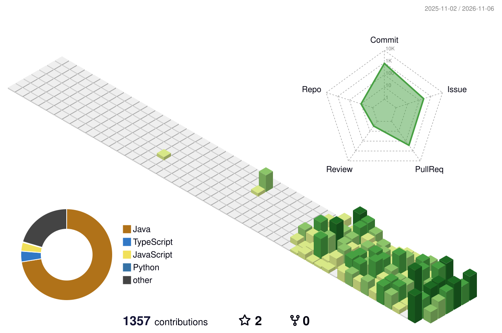

# 👋 Jisan Ahn

### ☁️ Cloud Infrastructure & Platform Engineering

> **Building reliable systems with a focus on cloud infrastructure, observability, and architecture.**

Backend development experience with a growing focus on cloud infrastructure, distributed systems, and operational reliability.

---

### 🛠️ Tech Stack

**☁️ Cloud & Infrastructure**

**⚙️ DevOps & Observability**

**💻 Development & Data**

---

### 🎓 Education & Training

- 🏫 **Korea Aerospace University** — B.S. in Software Engineering
- 💼 **LG CNS AM Inspire Camp, 6th Cohort** — Jul 2026 ~ Present
  - Application Modernization · MSA · Cloud · Kubernetes · DevOps
- 🧠 **Koala — Korea Aerospace University Algorithm Club** — Jul 2024 ~ Jun 2025
  - Data Structures · Algorithms · Problem Solving · Peer Code Reviews

### 🏅 Certifications & Language

**✅ Earned**

- 📊 **ADsP** — Advanced Data Analytics Semi-Professional
- 🗃️ **SQLD** — SQL Developer
- 🗣️ **OPIc IH** — Intermediate High

**📚 In Progress & Planned**

- 📝 **Engineer Information Processing (정보처리기사)** — Practical exam completed, result pending
- ☁️ **AWS SAA** — Solutions Architect – Associate (Target: 2026)
- ☸️ **CKA** — Certified Kubernetes Administrator (Target: Feb 2027)

---

### 🚀 Featured Projects

#### 🏟️ [Sporty v2](https://github.com/batontouch-sporty/platform)
**Deputy Team Lead · MSA Infrastructure, Observability & Reliability**

Designed the infrastructure architecture, integrated service metrics into Prometheus and Grafana, and built monitoring dashboards. Designed and ran Saga and failure-scenario tests.

🔗 [Dashboard PR](https://github.com/batontouch-sporty/frontend/pull/42) · [Infrastructure & Monitoring PR](https://github.com/batontouch-sporty/backend/pull/124) · [AWS QA Report](https://github.com/batontouch-sporty/platform/blob/main/docs/testing/AWS_FINAL_QA_REPORT.md)

#### 🔬 [Cloud Efficiency Lab](https://github.com/Ahnjisan/Cloud_Efficiency_Lab)
**Personal Research Project · Cloud Cost & Resource Efficiency**

Built InfraFit, a read-only CLI that combines synthetic billing, Terraform plans, and peak metrics to recommend changes, keep configurations, or defer decisions. Actual savings remain unverified.

🔗 [Final Research Report](https://github.com/Ahnjisan/Cloud_Efficiency_Lab/blob/main/FINAL-REPORT.md) · [InfraFit MVP](https://github.com/Ahnjisan/Cloud_Efficiency_Lab/blob/main/infrafit/README.md)

#### ☁️ TripMate
**Team Project · AWS Infrastructure**

Configured EC2, ALB, RDS, S3, and CloudFront with VPC networking and HTTPS, and analyzed infrastructure costs.

#### 🛡️ [FinGuardOps](https://github.com/Ahnjisan/FinGuardOps)
**Personal Project · System Architecture & Reliability**

Built transaction idempotency, recovery boundaries, authentication, and observability, then validated them with local integration tests.

#### 🧩 [DevField](https://github.com/thedevfield)
**Personal Project · Platform Architecture · In Progress**

Building a microservices-based developer training platform with independent services, authentication, and explicit API contracts.

#### 📄 [PDF Image Plagiarism Detection](https://github.com/Ahnjisan/muhayu-pdf-image-plagiarism-detection)
**Team Lead · Muhayu Project**

Led a team that extracted figures from research PDFs and compared image similarity methods with a Siamese network for plagiarism detection.

#### 🛡️ Multimodal Harmful Content Detection
**Team Lead · Muhayu Project**

Led a team developing a multimodal system for harmful content detection.

### 🌱 GitHub Contributions

<picture>
  <source
    media="(prefers-color-scheme: dark)"
    srcset="https://raw.githubusercontent.com/Ahnjisan/Ahnjisan/main/profile-3d-contrib/profile-night-green.svg"
  />
  
</picture>

---

📌 *Detailed architecture decisions, implementation, and validation evidence are available in the linked repositories.*
